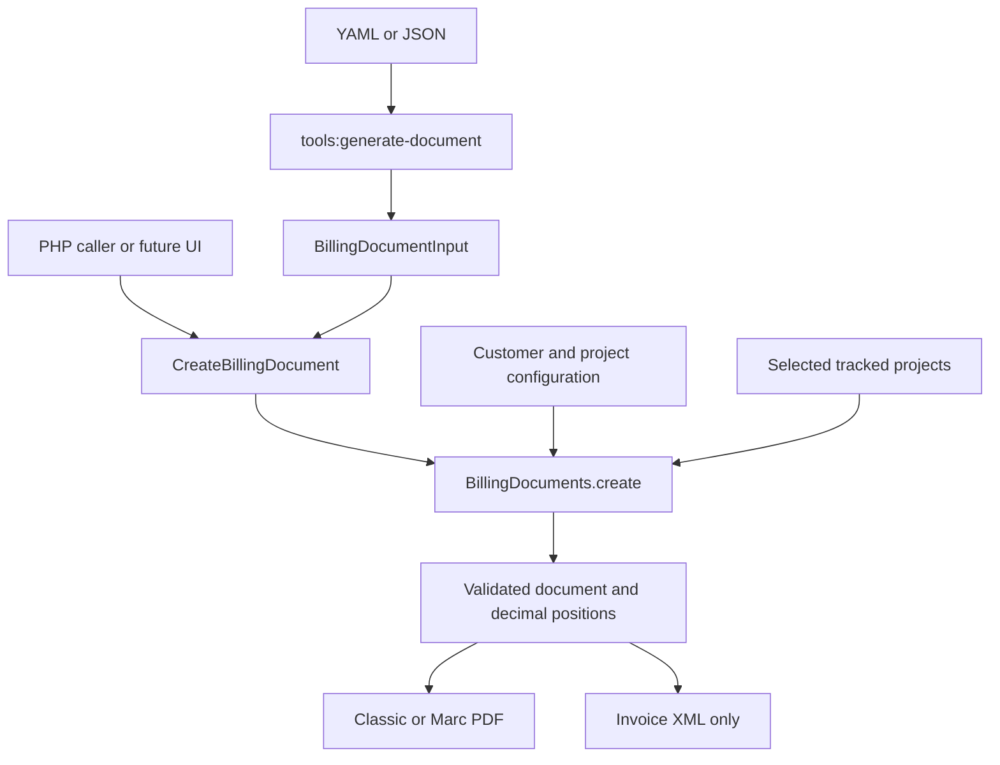

# Billing documents

## Entry points

The existing `tools:generate-timesheet` command remains available and generates a separate invoice for its project. The new document workflow is opt-in and does not require a CLI caller.



`BillingDocuments::create(CreateBillingDocument): Invoice` builds the document without exporting it. `BillingDocuments::generate(CreateBillingDocument): Invoice` exports it through the configured renderers. The existing `Invoice` component is reused for all document kinds; `documentType` controls meaning and export, not merely the heading.

```php
use Smoothie\FreelanceTools\Application\BillingDocuments;
use Smoothie\FreelanceTools\Application\CreateBillingDocument;
use Smoothie\FreelanceTools\Domain\Model\Common\Amount;
use Smoothie\FreelanceTools\Domain\Model\InvoiceItem;

$request = new CreateBillingDocument(
    number: 'RE-2026-001',
    customerId: 'example-customer',
    billingDate: '2026-02-01',
    deliveredAt: ['2026-01-01', '2026-01-31'],
    items: [new InvoiceItem(1, '1', 'Firmenwebsite', Amount::fromString('1499.00'), 'C62')],
    templateId: 'marc',
);

$document = $billingDocuments->create($request);
```

Here `$billingDocuments` is the injected `BillingDocuments` application service. A future UI can construct the same request, preview the returned document and explicitly trigger generation. No HTTP controller, editor, database, offer acceptance workflow, automatic email sender or payment reconciliation service is introduced.

## Customer identity

Configure an explicit `customerId` on every project that can be combined. The new workflow never groups projects merely because names match. Without `customerId`, the existing project ID remains a single-project customer lookup key.

```yaml
tools:
  organizations:
    - project: website
      customerId: example-customer
      templateId: marc
      name: Example GmbH
      street: Beispielstraße 1
      location: '10115 Berlin'
      country: DE
      vatId: DE123456789
      description: Website implementation
      taxRate: 19.0
      pricePerHour: 90.0
      termOfPaymentInDays: 14
    - project: maintenance
      customerId: example-customer
      templateId: marc
      name: Example GmbH
      street: Beispielstraße 1
      location: '10115 Berlin'
      country: DE
      vatId: DE123456789
      description: Technical support
      taxRate: 19.0
      pricePerHour: 90.0
      termOfPaymentInDays: 14
```

These are fictitious example details, not validated tax identities. Use actual recipient and sender information before delivery.

All projects of a customer must agree on recipient identity, VAT rate, payment terms, order number and default template. Different project descriptions and hourly rates are allowed. Conflicts fail rather than silently taking the first customer's settings. A selected project must belong to that customer exactly once.

## Optional CLI

```shell
bin/console tools:generate-document --input=docs/examples/billing-invoice.yaml
bin/console tools:generate-document --input=docs/examples/billing-advance.yaml
bin/console tools:generate-document --input=docs/examples/billing-final.yaml
bin/console tools:generate-document --input=docs/examples/billing-quote.yaml
bin/console tools:generate-document --input=invoice.json --template=marc
bin/console tools:generate-document --input=- < invoice.yaml
```

Copy the example to a working file and configure its `example-customer` first. Dates and all monetary values/quantities must be quoted in YAML. JSON requires decimal strings too, not binary floating-point numbers. Unknown fields, invalid dates, negative prices, nonpositive quantities and unsupported units are rejected.

Optional overrides are `--type=invoice|advance|final|quote`, `--template=classic|marc` and `--number=...`. An explicit document number is required; numbering and non-reuse remain the caller's responsibility. Files go to the configured export directory, usually `var/pdf/`. Regenerating the same document on the same day replaces its existing export. The command does not send documents.

### Manual positions

Each `items` entry has `description`, `quantity`, `pricePerItem` and optional `unit`. `HUR` means hours (default), `C62` means a count such as one package. Prices, descriptions and quantities are supplied by the caller, not fixed to the example prices. Multiple projects or package/additional-work lines can also be entered manually.

Manual line net totals are quantity × net unit price, rounded HALF_UP to two decimal places. Invoice net is the sum of those line totals; VAT is rounded on that sum; gross is net plus VAT. Arithmetic uses decimal numbers. Manual quantities and unit prices support up to six decimal places and must be below 1000000; invoice XML totals must be below EUR 10000000000000. These explicit bounds preserve precision across the XML library's float-based interface. Unit prices retain their supported decimal places in the PDF and XML; line/document totals use cents.

The supported scope is EUR and one positive standard VAT rate with at most two decimal places per document; mixed rates, exemptions, reverse charge, credits and discounts need explicit future modelling.

### Tracked projects in one invoice

```yaml
number: 'RE-2026-002'
customerId: example-customer
billingDate: '2026-02-01'
projects: [website, maintenance]
performancePeriod: LAST_MONTH
startDate: '2026-02-01'
templateId: marc
```

This generates one position per selected project from tracked seconds and that project's hourly rate. Pricing uses `seconds × hourly rate ÷ 3600`, rounding only the final line total; a repeating decimal hour quantity is never used as an intermediate monetary value. PDFs display tracked durations as `h:mm:ss`; XML uses exact seconds (`SEC`) with a price basis of 3600 seconds. For example, 3607 seconds at EUR 90/hour gives EUR 90.18, not EUR 90.17. The original timesheet command retains its existing whole-hour rounding behavior. `CURRENT_MONTH`, `LAST_MONTH` and `LAST_TWO_MONTHS` are supported. The period is calculated without changing the shared clock. Missing tracked time or an unexpected project from the provider fails explicitly.

For tracked projects, service dates are derived from the performance period. If `deliveredAt` is also supplied, it must equal the derived start/end dates. Manual `items` may be combined with tracked positions. This command does not generate individual timesheet attachments; use the existing timesheet workflow for those separately.

## Templates

`classic` retains the existing layout and is the default. `marc` adds the yellow line, Poppins/Mulish typefaces and Form-B-oriented letter zones from the supplied examples. It supports invoice, advance, final and quote variants. The choice is available per customer, per request or as a CLI override. Template identifiers are allowlisted; arbitrary filesystem paths are not accepted.

The Marc template follows the concrete invoice PDFs: compact 12 pt headings, grey grid tables and a net/VAT/gross settlement table, rather than applying the generic 22 pt document-title rule. Its reference font files use isolated font families so Classic keeps its existing font metrics. Metadata labels and values occupy separate lines; expected service dates appear in the body, outside the narrow metadata column.

Classic keeps its original ordinary-invoice styling. Footer columns use absolute positions rather than floats, which otherwise corrupt Dompdf pagination. New final invoices use compact settlement wording without the ordinary invoice's greeting block.

The integration examples generate the final merged PDFs, YAML, XML and HTML source under `var/billing-examples/`. Page-count regressions require every short invoice/advance/final example to fit on one page in both layouts; offers allow two pages and the 35-position case at most six. The HTML source exposes landmarks, headings and table headers for inspection, but is not a browser-equivalent PDF preview. Browser review compares rasterized PDFs with the supplied reference PDFs. The reviewed Classic invoice and Marc final HTML passed axe WCAG A/AA checks with no reported violations; this does not establish tagged PDF or PDF/UA accessibility conformance, nor pixel identity for arbitrary content.

The new template is tested for letter-zone coordinates, embedded fonts, multipage tables, repeated footer and page numbers. This is not a declaration of complete DIN compliance. The original `Marc_Page_Design` folder remains untracked; only the required new font and templates are included.

## Advances and final invoices

`documentType: advance` means an agreed payment before performance, not a completed partial service. Enter the advance as a position, for example `1 × 749.50` for 50% of a EUR 1499.00 net package. The advance example marks the service period as expected. A partial invoice for completed milestones is not automatically treated as an advance.

A `final` document contains the **entire** delivered service. Its `advancePayments` list contains only money actually received, with the referenced invoice number/date, receipt date and received net/VAT/gross amounts. An issued but unpaid advance invoice is not a receipt and must not be entered. For a partly paid advance invoice, enter only the received portion. Each advance invoice can be referenced once per final invoice; consolidate its received portions before entry and use the date of the latest included receipt.

| Calculation | Net EUR | VAT EUR | Gross EUR |
| --- | ---: | ---: | ---: |
| Full website | 1499.00 | 284.81 | 1783.81 |
| Received 50% advance | 749.50 | 142.41 | 891.91 |
| Remaining | 749.50 | 142.40 | 891.90 |

The final XML keeps full net/VAT/gross totals and deducts prepaid gross in the amount due; it does not create negative sales positions or tax the advance twice. For compatibility with the EN16931 D16B schema, the first advance appears as the structured previous-invoice reference; **all** advances, receipt dates and net/VAT/gross splits appear in document notes. Multiple structured previous-invoice elements are deliberately avoided because the tested D16B validator permits only one. PDF details show each receipt and its tax breakdown. Duplicate advance references, self-references, future receipts, inconsistent VAT and overpayment fail. Payments on non-final documents fail.

Receipt data are caller-supplied evidence, not bank-verified events. There is no central ledger preventing reuse of an advance across different final documents. Preserve the original advance invoices and payment evidence; settlement scope and references must be checked before issuance.

## Offers

`documentType: quote` generates **PDF only**, with its own caller-supplied offer number. `billingDate` is the offer date; `termOfPaymentInDays` is used as the validity period for this document kind. Expected performance dates go in `deliveredAt`. Scope, exclusions, budget, payment plan and acceptance wording go in `documentNotes`; `reference` identifies an existing proposal/order if applicable.

The examples include a fixed-price [website offer](examples/billing-quote.yaml) with scope, exclusions and payment plan, and a [technical-support budget offer](examples/billing-quote-hours.yaml) with a work package and approval limit. These are editable examples, not global commercial terms.

For an accepted offer, retain the agreed positions in its input file, select an appropriate new document number, update dates and explicitly switch to `advance` or `invoice`. A quoted hours budget is not already delivered work: replace the budget quantity with actual documented hours before invoicing, or enter the actual tracked projects separately. Changing `--type` does not create an acceptance record or automatically calculate a 50% advance. A final invoice uses full positions plus actual received payments. Keep the accepted offer file and contractual reference alongside the subsequent documents.

Offers are not exported as XRechnung, ZUGFeRD or invoice XML. Calling the e-invoice builder with a quote is rejected.

## Structured invoice scope

Invoice, advance and final exports use the existing ZUGFeRD **EN16931 CII profile**, preserving separate positions and matching PDF totals. The invoice types are 380 for ordinary/final invoices and 386 for prepayment invoices. XSD validation runs during XML generation.

Manual verification also covered a standard invoice, an advance, a final invoice with two received advances, a fully prepaid final invoice and a precision case with exact seconds/fractional prices. All five passed KoSIT 1.5.0 using the standalone **EN16931 (CII)** scenario from configuration XRechnung 3.0.2 / release-2024-10-31 (CII D16B XSD and CEN Schematron 1.3.12). The configuration's name does not mean its XRechnung scenario was selected. These are synthetic test cases against a pinned ruleset, not a guarantee for arbitrary production data or current recipient requirements. The Java validator is not a runtime dependency or an automatic CI gate.

External revalidation can use a separately installed KoSIT validator/configuration:

```shell
java -jar /path/to/validationtool-1.5.0-standalone.jar \
  -r /path/to/configuration -s /path/to/configuration/scenarios.xml \
  -h /path/to/generated-invoice.xml
```

Inspect the generated report's selected scenario and validation steps, not merely successful XML parsing. The standalone EN16931 scenario must pass both schema and business rules. Upgrade the ruleset deliberately when validating for a recipient.

**EN16931-profile XML plus XSD validation is not a completed XRechnung conformance check.** The application does not yet offer an XRechnung-specific profile with buyer routing reference/electronic address and a current KoSIT business-rule validation gate. Do not label these exports as validated XRechnung. Recipient-specific requirements and a business-rule validator remain necessary before that delivery channel is enabled.
